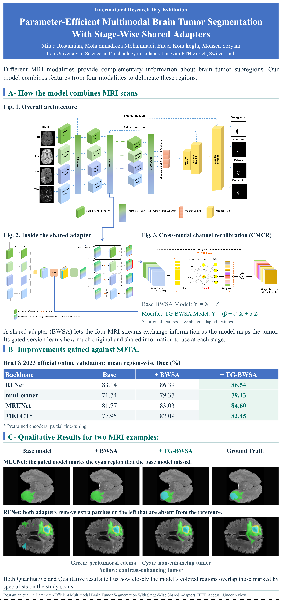

# BWSA and TG-BWSA

**Parameter-Efficient Multimodal Brain Tumor Segmentation With Stage-Wise Shared Adapters**

Milad Rostamian, Mohammadreza Mohammadi, Ender Konukoglu, and Mohsen Soryani

[](assets/poster.pdf)

[Poster (PDF)](assets/poster.pdf)

## Overview

BWSA combines features from separate MRI modality encoders through a shared adapter at each encoder stage. TG-BWSA extends BWSA with learned weights for the original and adapted features. We evaluate both forms on BraTS 2020 and BraTS 2023 using RFNet, mmFormer, MEUNet, and MEFCT.

## Results

Mean region-wise Dice (%) on the official BraTS 2023 online validation set.

| Backbone | Base | BWSA | TG-BWSA |
|---|---:|---:|---:|
| RFNet | 83.14 | 86.39 | 86.54 |
| mmFormer | 71.74 | 79.37 | 79.43 |
| MEUNet | 81.77 | 83.03 | 84.60 |
| MEFCT | 77.95 | 82.09 | 82.45 |

MEFCT uses pretrained encoders with partial fine-tuning. [Online evaluation reports](results/online/) include submission identifiers and regional metrics.

## Repository

- [Updated code](updated_code/): RFNet/mmFormer training with explicit validation lists, checkpoint selection, model definitions, and inference scripts.
- [Original code](old_code/): the previous implementations.
- [Data](data/): subject lists and transfer-cohort metadata.
- [Evaluation](evaluation/): patient-level statistical analysis and image-quality evaluation.
- [Results](results/): per-case scores, online reports, and source result files.
- [Configuration](configs/): software environment and experiment settings.

## Usage

The exact training, internal-validation, and local-evaluation lists for BraTS 2020 and BraTS 2023 are in [data/splits](data/splits/). See [Data](data/) for counts and the separate additional RFNet and transfer experiments.

Install the model dependencies specified in [configs](configs/). Obtain the BraTS data and set the data and checkpoint paths in the model scripts before training or inference.

The generated 900/100 subdivisions for the two additional RFNet development sets are provided for new runs. They do not replace the saved training settings of existing checkpoints. See [updated code](updated_code/) for training and final-evaluation commands.

For statistical analysis of the saved scores:

```bash
pip install -r requirements.txt
python evaluation/bootstrap_local.py
python evaluation/bootstrap_transfer.py
```

## Trained weights

Trained weights and experiment-specific configurations are available from the corresponding author upon reasonable request.

## Acknowledgments

We thank the authors of RFNet, mmFormer, Fully Convolutional Transformer, and LoRA for their implementations. See [THIRD_PARTY.md](THIRD_PARTY.md).
